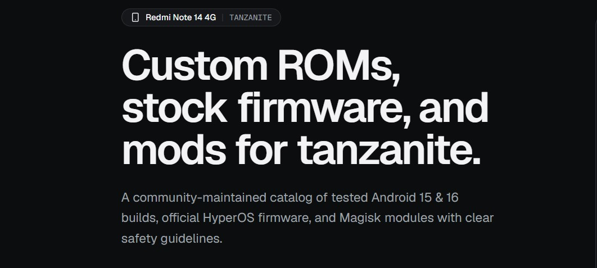

# Tanzanite: Redmi Note 14 4G Firmware & Custom ROM Catalog

An open-source, community-maintained directory of verified custom ROMs, official stock Fastboot firmware, ported builds, system modules, and debloating resources for the Redmi Note 14 4G (codename: `tanzanite`).

- **Live Deployment:** [https://Joy-S-S.github.io/Redmi-Note-14-4G-Custom-ROMs](https://Joy-S-S.github.io/Redmi-Note-14-4G-Custom-ROMs)
- **Telegram Support:** [https://t.me/JoySS_Support](https://t.me/JoySS_Support)
- **Community Channel:** [https://t.me/RN14ID](https://t.me/RN14ID)
- **YouTube Channel:** [https://www.youtube.com/@Joy_Sayed](https://www.youtube.com/@Joy_Sayed)

---

## Overview

The Tanzanite platform centralizes development resources for the Redmi Note 14 4G into a high-performance web catalog. The project replaces dispersed forum threads and unindexed Telegram posts with structured metadata, verified download mirrors, side-by-side changelogs, full device screenshot previews, and standardized safety guidelines.

---

## Core Catalog Sections

### 1. Custom ROMs
- Curated collection of AOSP, LineageOS, Pixel-based, and OEM-derived community builds.
- Clear distinction between packages including Google services (`Download (GApps)`) and clean, Google-free releases (`Download (Vanilla)`).
- Filterable by Android version (Android 15, 16, 17), GApps inclusion, maintainer, and update date.
- Modal inspection with interactive multi-image galleries, maintainer notes, and reported issues.

### 2. Stock Fastboot Firmware
- Direct, unadulterated official Xiaomi HyperOS fastboot packages (`.tgz`) for restoring factory state, recovering from bootloops, and unbricking.
- Regional package coverage: Global (GL), Europe (EU), Indonesia (ID), Russia (RU), Taiwan (TW), and Turkey (TR).
- Filterable by region and HyperOS generation (HyperOS 1.0, 2.0, 3.0).
- Download buttons point directly to official Xiaomi content delivery network mirrors.

### 3. Ported ROMs
- Experimental ports adapted from sister MediaTek devices for experienced enthusiasts seeking alternative OEM user interfaces.
- Clear indicators regarding original donor devices, boot requirements, and verified maintainer contacts.

### 4. System Modules & Tweaks
- Tested Magisk and KernelSU modules tailored specifically for the Redmi Note 14 4G.
- Includes audio optimization engines (Dolby Atmos, ViPER4Android), thermal management profiles, and camera modifications.

### 5. Debloat Toolkit
- Interactive package manager with safe ADB command generation to remove bloatware, telemetry, and advertising packages.
- Explicit safeguards warning against removing critical system packages.

### 6. Interactive Flashing Guide
- Step-by-step documentation detailing bootloader unlocking prerequisites, vendor boot partition requirements, recovery flashing, and clean installation protocols.

---

## Device Specifications

| Specification | Details |
| :--- | :--- |
| **Device Model** | Xiaomi Redmi Note 14 4G |
| **Codename** | `tanzanite` |
| **Platform** | MediaTek Helio G99-Ultra (6 nm) |
| **CPU Architecture** | Octa-core (2x 2.2 GHz Cortex-A76 & 6x 2.0 GHz Cortex-A55) |
| **GPU** | Mali-G57 MC2 |
| **Display** | 6.67" AMOLED, 120 Hz, 1080 x 2400 pixels, Corning Gorilla Glass 5 |
| **Primary Camera** | 108 MP (wide) + 2 MP (depth) |
| **Battery & Charging** | 5,500 mAh, 33 W fast charging |
| **Launch OS** | Xiaomi HyperOS 1.0 (Android 14) |

---

## Technical Stack

The platform is built as a fully static, zero-runtime-server Next.js application optimized for edge delivery via GitHub Pages:

- **Framework:** Next.js 16 (App Router)
- **UI Architecture:** React 19, TypeScript
- **Styling:** Tailwind CSS v4, Base UI / Radix UI primitives
- **Icons:** Lucide Icons
- **Asset Optimization:** WebP image transcoding via Sharp, automated responsive image manifests
- **Build Output:** Fully static HTML/CSS/JS export (`next build`) with client-side URL state synchronization
- **Automation:** GitHub Actions workflow for weekly official stock firmware synchronization and automatic GitHub Pages deployment

---

## Important Safety Information

- **Bootloader Requirement:** Unlocking the bootloader is mandatory for installing any custom ROM, recovery, or flashing stock firmware via Fastboot.
- **Data Preservation:** Bootloader unlocking and installing a new custom ROM automatically triggers a factory reset. Always maintain comprehensive off-device backups before proceeding.
- **Bootloader Relocking Warning:** Never attempt to relock the bootloader while running a custom ROM, a ported ROM, modified system partitions, or firmware from a different geographical region. Relocking under these conditions will result in a hard brick.
- **Liability:** Custom firmware installation involves inherent risks. Users proceed at their own discretion.

---

## License

This project is licensed under the MIT License. Official firmware binaries and custom ROM distributions are the property of their respective maintainers and Xiaomi Inc.
